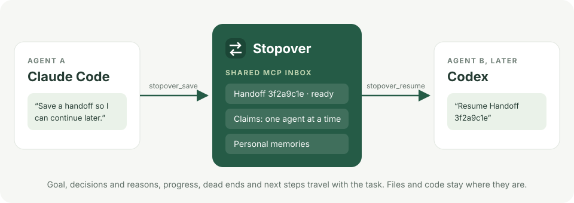
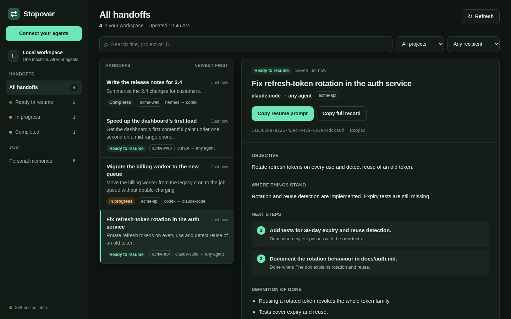

# Baton

**Save work in one AI coding agent and continue it in another.**

Baton is a small, self-hosted server with a web dashboard. It connects through MCP, the protocol agents use to call external tools. Your agent saves a summary of the goal, decisions, progress, and next steps. Another connected agent reads that summary and continues the task.



Run Baton on your computer for local use, or share it privately across your devices with Tailscale. It has no accounts or built-in authentication: anyone who can reach it shares access to all handoffs and personal memories.

## Quickstart

You need Git and Docker Engine 28+ with Compose v2, or current Docker Desktop. Docker is needed only on the machine running Baton.

```sh
git clone https://github.com/HiddenVectr/Baton.git
cd Baton
docker compose up --build -d --wait --wait-timeout 60
docker compose ps
```

Open **http://127.0.0.1:8765**. The start command waits for the service to become healthy. The dashboard starts empty. If it does not open, check `docker compose logs --tail=50 baton`.

## Connect your agent

Choose the command for your agent:

```sh
# Claude Code
claude mcp add --scope user --transport http baton http://127.0.0.1:8765/mcp

# Codex
codex mcp add baton --url http://127.0.0.1:8765/mcp
```

Start a fresh agent session. Ask it:

> List my Baton handoffs without claiming any.

An empty successful result confirms the connection. For Cursor, OMP, Hermes, Muse Code, and other MCP clients, see [client setup](docs/clients.md). The dashboard's **Connect your agents** button also shows the server URL and setup commands.

## Save and resume

In your connected agent, say:

> Save a handoff so I can continue this conversation later.

The agent saves a summary and gives you a prompt such as `Resume Handoff <id>`.

Connect your other agent to the same Baton server, start a fresh session, and paste the prompt. It claims the handoff and continues using the saved context. You can also copy the prompt from the dashboard.



The receiving agent needs access to the project files. Baton saves summaries rather than full transcripts, does not transfer files, and does not start agents for you. A claim helps coordinate work; it cannot prevent an agent from editing files after its claim expires.

## Share personal context

To save preferences and relevant personal context, say:

> Update my Baton memory.

In another connected agent, say:

> Import my Baton memory.

Browse saved memories in **Personal memories**. Ask an agent to correct or forget a specific memory. Baton stores one shared collection; each agent decides whether to retain imported context locally.

## Keep your data private

The supplied Compose file publishes Baton on localhost. **Do not expose this deployment to the public internet.** For access from your other devices, use [Tailscale Serve with restricted access rules](docs/remote-http.md).

Do not save credentials or secrets. Context an agent reads may be sent to that agent's model provider.

Handoffs and memories survive container restarts in the Docker volume. **`docker compose down -v` deletes that volume.** See [operations](docs/operations.md) for backups, restore, and updates.

## More information

- [Using Baton](docs/usage.md): everyday workflows and troubleshooting.
- [Client setup](docs/clients.md): commands and configuration for each agent.
- [API reference](docs/api.md): tool contracts, retries, claims, and pagination.
- [Operations](docs/operations.md): storage, configuration, backups, and retention.
- [Tailscale deployment](docs/remote-http.md): private access across devices.
- [Implementation](docs/implementation.md): architecture and extension points.
- [Changelog](CHANGELOG.md): changes and upgrade notes.
- [Security policy](SECURITY.md): how to report a vulnerability privately, and what Baton does and doesn't protect.

## Development

```sh
python3 -m venv .venv
.venv/bin/pip install -r requirements-dev.lock
.venv/bin/pip install --no-deps -e .
.venv/bin/python -m playwright install chromium
.venv/bin/python -m pytest -q
```

On Windows, use executables in `.venv\Scripts\`. See [local development](docs/implementation.md#local-development) for running without Docker and regenerating screenshots.

Contributions are welcome; see [CONTRIBUTING.md](CONTRIBUTING.md). Baton is pre-1.0: a minor release can include breaking changes, always marked in the [changelog](CHANGELOG.md), and only the latest release gets fixes.

## License

[Apache License 2.0](LICENSE).
