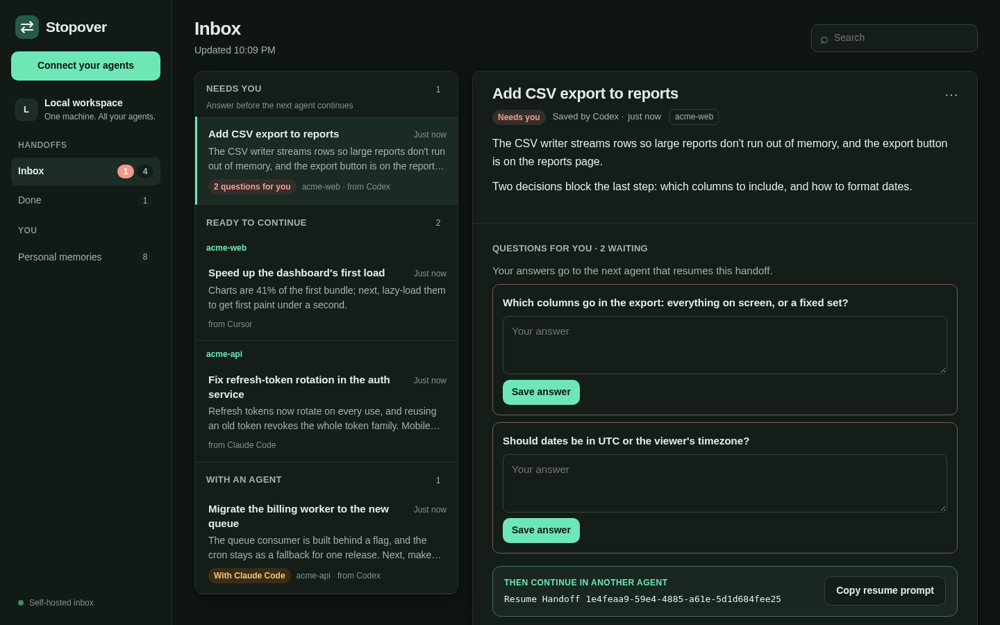

# Stopover

**A self-hosted inbox for your AI agents' work.**

You use more than one AI agent: Claude Code today, Codex when you hit a usage limit, Cursor on the other machine. Each one starts from zero. Stopover gives them one place to leave work and pick it up again, and gives you one place to see what's waiting.

- **Hand work between agents.** Say "save a handoff" in one agent. Another agent, even on another machine, resumes with the goal, decisions, progress and next steps, without you re-explaining anything.
- **See what needs you.** The dashboard's inbox sorts open work into *Needs you*, *Ready to continue* and *With an agent*, grouped by project.
- **Answer your agents' questions.** When an agent stops with open questions, answer them in the dashboard. The next agent that picks up the work gets your answers.
- **No double work.** Resuming a handoff claims it, so two agents don't work on the same task. A claim lasts an hour unless the agent renews it; after that, any agent can continue the work.
- **Finished means checked.** An agent can only mark work succeeded with evidence for each acceptance criterion, and the outcome stays with the handoff.
- **Bring your preferences along.** A shared personal memory ("prefers short answers", "uses pnpm") that every connected agent can read and update.


Stopover is a small server with a web dashboard. Agents connect through MCP, the protocol they use to call external tools, so it works with Claude Code, Codex, Cursor, Hermes, OMP and any other MCP client. It runs in one Docker container on your machine, and everything stays in a local SQLite database.

## Quickstart

You need Git and Docker Engine 28+ with Compose v2, or current Docker Desktop. Docker is needed only on the machine running Stopover.

```sh
git clone https://github.com/HiddenVectr/Stopover.git
cd Stopover
docker compose up --build -d --wait --wait-timeout 60
```

Open **http://127.0.0.1:8765**. The dashboard starts empty. If it doesn't open, check `docker compose logs --tail=50 stopover`.

## Connect your agents

Add Stopover to each agent you use:

```sh
# Claude Code
claude mcp add --scope user --transport http stopover http://127.0.0.1:8765/mcp

# Codex
codex mcp add stopover --url http://127.0.0.1:8765/mcp
```

Start a fresh session and ask:

> List my Stopover handoffs without claiming any.

An empty successful result means it works. For Cursor, OMP, Hermes, Muse Code and other clients, see [client setup](docs/clients.md), or use the dashboard's **Connect your agents** button.

## How you use it

**1. Save when you stop.** Out of usage, done for the day, or switching machines? In your agent, say:

> Save a handoff so I can continue this conversation later.

The agent writes a summary of a paragraph or two plus the details the next agent needs, and replies with a prompt such as `Resume Handoff 9b1bc726-…`. Claude Code and Codex can install [short commands](docs/usage.md#short-commands) such as `/stopover-save` and `$stopover-resume`.

**2. Continue in another agent.** Open the other agent and paste the prompt, or copy it from the dashboard. The agent claims the handoff, restates where things stand, and carries on.


**3. Check the inbox.** The dashboard opens on what to do next. **Needs you** lists handoffs whose agent left questions; **Ready to continue** is work waiting for an agent; **With an agent** is work someone has picked up. Finished work moves to **Done** with its outcome. With nothing selected, **Next up** shows the one thing to look at first.

**4. Answer questions.** Open a handoff in **Needs you**, type your answers and save. They're stored alongside the handoff, never changing what the agent saved, and the next agent to read or resume it gets them.



Each handoff opens with its summary and the prompt to continue it. Next steps follow; the full record (objective, decisions, what was tried, references and history) is folded underneath for when you need it.

### What Stopover doesn't do

- **It doesn't move your files.** The agent that continues needs its own access to the repository and tools.
- **It doesn't start agents.** Work waits in the inbox until you open an agent and resume it.
- **A claim isn't a lock.** It tells other agents the work is taken; it can't stop an agent from editing files after its claim expires.
- **It saves summaries, not transcripts.** A handoff holds what the agent chose to write down. Check that important details made it in before closing the original session.

## Personal memory

Handoffs carry one task. Personal memory carries what your agents know about *you*, so a new agent doesn't start from zero. Say "update my Stopover memory" in one agent and "import my Stopover memory" in another. Browse, correct or forget memories from any agent, and see them all under **Personal memories** in the dashboard. See [personal memory](docs/memory.md) for what's saved and how forgetting works.

## Keep your data private

Stopover has no accounts or built-in authentication: anyone who can reach it can read and change every handoff and memory. The supplied Compose file listens on localhost only. **Don't expose it to the public internet.** To use it from your other devices, put it behind [Tailscale Serve with access rules](docs/remote-http.md).

Don't save credentials or secrets in handoffs. Anything an agent reads may be sent to that agent's model provider.

Data survives container restarts in a Docker volume. **`docker compose down -v` deletes it.** See [operations](docs/operations.md) for backups, restore, retention and updates.

## More information

- [Using Stopover](docs/usage.md): saving, finding, resuming and answering handoffs.
- [Personal memory](docs/memory.md): sharing your preferences and context between agents.
- [Client setup](docs/clients.md): commands and configuration for each agent.
- [API reference](docs/api.md): tool contracts, claims, answers, retries and the dashboard API.
- [Operations](docs/operations.md): storage, configuration, backups and retention.
- [Tailscale deployment](docs/remote-http.md): private access across your devices.
- [Implementation](docs/implementation.md): how Stopover works inside, and its extension points.
- [Changelog](CHANGELOG.md): changes and upgrade notes.
- [Security policy](SECURITY.md): reporting a vulnerability, and what Stopover does and doesn't protect.

## Development

```sh
python3 -m venv .venv
.venv/bin/pip install -r requirements-dev.lock
.venv/bin/pip install --no-deps -e .
.venv/bin/python -m playwright install chromium
.venv/bin/python -m pytest -q
```

On Windows, use the executables in `.venv\Scripts\`. See [local development](docs/implementation.md#local-development) for running without Docker and regenerating screenshots.

Contributions are welcome; see [CONTRIBUTING.md](CONTRIBUTING.md). Stopover is pre-1.0: a minor release can include breaking changes, always marked in the [changelog](CHANGELOG.md), and only the latest release gets fixes.

## License

[Apache License 2.0](LICENSE).
