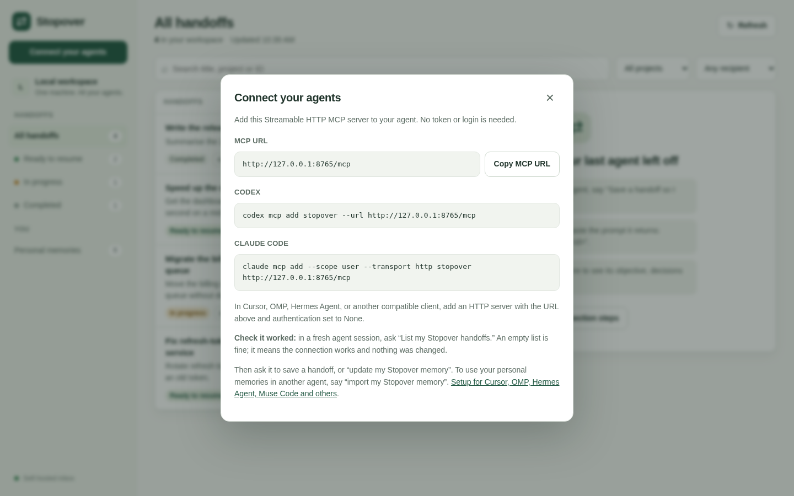

# Connect an AI agent

Stopover works with any MCP client that supports **Streamable HTTP**. This page has setup steps for each client, how to verify the connection, and troubleshooting.

**Quickest route:** open the dashboard and click **Connect your agents**. It shows the MCP URL and ready-to-paste commands with your server's address filled in.



Every client uses the same connection details:

| Setting | Value |
| --- | --- |
| Transport | Streamable HTTP (often labeled `http`) |
| Local MCP URL | `http://127.0.0.1:8765/mcp` |
| Tailscale MCP URL | The Serve HTTPS URL plus `/mcp`, for example `https://myserver.example-tailnet.ts.net/mcp` |
| Stopover authentication | None — no token, headers, or environment variables |

For Tailscale hosting, replace `http://127.0.0.1:8765/mcp` in any example below with your Serve HTTPS URL plus `/mcp`. The machine or runtime making the MCP request must be able to reach your tailnet. Docker and Python are needed only on the Stopover server, not on clients.

For a server on another machine, see [Tailscale deployment](remote-http.md).

Choose your client: [Codex](#codex), [Claude Code](#claude-code), [Cursor](#cursor), [OMP / Oh My Pi](#omp--oh-my-pi), [Hermes Agent](#hermes-agent), [Muse Code (Meta)](#muse-code-meta), or [generic MCP client](#generic-mcp-client).

Use the add command where one is shown below; editing the configuration file is an alternative. Choose one method per client. When editing files, merge the example into your existing configuration rather than replacing it, and don't register Stopover twice.

## Codex

**Option 1 — add command (recommended)**

```bash
codex mcp add stopover --url http://127.0.0.1:8765/mcp
codex mcp list
```

If an old registration needs to be removed first, run `codex mcp remove stopover`, then rerun the add command.

**Option 2 — edit TOML**

Merge [clients/codex.toml](../clients/codex.toml) into `~/.codex/config.toml`, or `.codex/config.toml` for a trusted project:

```toml
[mcp_servers.stopover]
url = "http://127.0.0.1:8765/mcp"
startup_timeout_sec = 15
tool_timeout_sec = 30
```

Start a fresh Codex session and use `/mcp` in the CLI to check the connection. `codex mcp list` lists registrations. Use the configuration file belonging to the Codex home used by your CLI, desktop app, or IDE extension.

Reference: [OpenAI MCP documentation](https://learn.chatgpt.com/docs/extend/mcp?surface=cli).

## Claude Code

**Option 1 — add command (recommended)**

```bash
claude mcp add --scope user --transport http stopover http://127.0.0.1:8765/mcp
claude mcp list
```

For project scope, replace `--scope user` with `--scope project`. If an old user registration already exists, run `claude mcp remove --scope user stopover` before adding it again; use the matching scope for a project or local registration.

**Option 2 — edit JSON**

Merge [clients/claude-code.json](../clients/claude-code.json) into `.mcp.json` at your project's root:

```json
{
  "mcpServers": {
    "stopover": {
      "type": "http",
      "url": "http://127.0.0.1:8765/mcp"
    }
  }
}
```

Open a fresh Claude Code session, approve the project configuration if prompted, and use `/mcp` to check the connection.

Reference: [Claude Code MCP documentation](https://code.claude.com/docs/en/mcp).

## Cursor

Merge [clients/cursor.json](../clients/cursor.json) into `~/.cursor/mcp.json` for your user account, or `.cursor/mcp.json` for a project:

```json
{
  "mcpServers": {
    "stopover": {
      "url": "http://127.0.0.1:8765/mcp"
    }
  }
}
```

Reload Cursor if necessary, enable `stopover` in its MCP settings, and check that the tools are available to the agent.

Reference: [Cursor MCP documentation](https://cursor.com/docs/mcp).

## OMP / Oh My Pi

Merge [clients/omp.json](../clients/omp.json) into `.omp/mcp.json` for a project or `~/.omp/agent/mcp.json` for your default user profile:

```json
{
  "mcpServers": {
    "stopover": {
      "type": "http",
      "url": "http://127.0.0.1:8765/mcp"
    }
  }
}
```

Named profiles use `~/.omp/profiles/<name>/agent/mcp.json`. In OMP, run:

```text
/mcp reload
/mcp list
/mcp test stopover
```

OMP may discover an existing Stopover entry from another client. Check `/mcp list` for its source and replace any old command-based entry rather than adding a duplicate.

Reference: [Oh My Pi MCP configuration](https://github.com/can1357/oh-my-pi/blob/main/docs/mcp-config.md).

## Hermes Agent

**Option 1 — add command (recommended)**

```bash
hermes mcp add stopover --url http://127.0.0.1:8765/mcp
hermes mcp list
hermes mcp test stopover
```

For a Tailscale server, use its HTTPS endpoint instead:

```bash
hermes mcp add stopover --url https://myserver.example-tailnet.ts.net/mcp
```

Use your actual Serve hostname. If replacing an existing registration, run `hermes mcp remove stopover` first. No `--auth` option or login is needed.

**Option 2 — edit YAML**

Merge [clients/hermes.yaml](../clients/hermes.yaml) into `~/.hermes/config.yaml` (or the `config.yaml` in your active `HERMES_HOME`):

```yaml
mcp_servers:
  stopover:
    url: "http://127.0.0.1:8765/mcp"
```

Replace the URL with your Tailscale endpoint when hosting remotely. Start a fresh `hermes chat` session or run `/reload-mcp` in an existing session. Hermes exposes tools with names such as `mcp_stopover_stopover_save`. Ask it to list handoffs to verify a tool call, then try the [save and resume workflow](../README.md#save-and-resume).

References: [Hermes MCP guide](https://hermes-agent.nousresearch.com/docs/user-guide/features/mcp/), [Hermes CLI reference](https://hermes-agent.nousresearch.com/docs/reference/cli-commands/).

## Muse Code (Meta)

Muse Code, Meta's coding agent, reads MCP servers from the `mcp_servers` block of `~/.config/muse/settings.json`. Merge [clients/muse-code.json](../clients/muse-code.json) into it:

```json
{
  "mcp_servers": {
    "stopover": {
      "transport": "streamable_http",
      "url": "http://127.0.0.1:8765/mcp",
      "mode": "optional"
    }
  }
}
```

`"mode": "optional"` lets Muse Code start with a warning when Stopover isn't running; the default (`required`) aborts the run instead. Start a new session and run `/mcp` to check that `stopover` is connected and lists its tools.

The **Muse app** (not Muse Code) has no user-facing MCP setting: its connectors come from Meta's catalog, and work it runs on Meta's cloud machines can't reach `127.0.0.1` or your tailnet. A self-hosted Stopover therefore works only with Muse Code on your own machine.

This setup follows Meta's documented keys (`transport`, `url`, `mode`); it has not been tested end to end yet. Reference: [Muse Code: extending](https://dev.meta.ai/docs/muse-code/extending).

## Generic MCP client

Add a server named `stopover`, select **Streamable HTTP**, enter `http://127.0.0.1:8765/mcp` or your Tailscale HTTPS endpoint, and leave authentication set to **None**. No command, token, or authorization header is needed.

[clients/generic-http.json](../clients/generic-http.json) illustrates a common JSON configuration shape. Adapt its wrapper to your agent; MCP does not define a universal client configuration file. Clients must support Streamable HTTP; legacy SSE-only clients need a compatible adapter.

## Verify a connection

The client should discover eleven tools: the seven handoff tools `stopover_save`, `stopover_list`, `stopover_get`, `stopover_claim`, `stopover_resume`, `stopover_complete`, and `stopover_delete`, plus the four [personal memory](memory.md) tools `stopover_memory_read`, `stopover_memory_update`, `stopover_memory_forget`, and `stopover_memory_export`. Five prompts are available: `save`, `resume`, `inbox`, `memory-update`, and `memory-import`. Some clients prefix tool names with the server name.

Ask the agent:

> Use Stopover's stopover_list with status="all" and limit=5. Report whether the call succeeds. Do not create or claim a handoff.

An empty successful result is fine. A configured-server listing alone does not prove that tool calls work. After this read-only check, save a handoff in one client and resume it in another to test a transfer.

## Troubleshooting connections

- **Client asks for a token or login:** Stopover needs none. Remove any `bearer_token_env_var` setting or `Authorization` header from the registration, or remove and re-add it with the commands above.
- **Connection refused:** verify the server is running and the URL is reachable from the agent. `127.0.0.1` always refers to the client's own machine or runtime; a remote agent needs a reachable server URL.
- **HTTP 403:** Stopover rejects browser requests from other sites: an `Origin` that isn't the Stopover server, or `Sec-Fetch-Site: cross-site`. Open the dashboard directly at its Serve URL. A 403 saying `Host not allowed` means the server was reached by a name or IP outside its allowlist; add it to `STOPOVER_ALLOWED_HOSTS`. For remote connectivity problems, check Tailscale access rules and `tailscale serve status`.
- **Server registered but tools missing:** reload the MCP configuration or start a fresh client session, check that the server is enabled, and approve project configuration where required.
- **Client tries to run a command:** the registration is command-based (`command` and `args`). Replace it with the HTTP example for that client; the HTTP connection runs nothing on the client.
- **Server diagnostics:** the operator can run `docker compose ps` and `docker logs --tail 50 stopover` on the server.

## Legacy stdio clients

The older stdio bridge (`python -m stopover bridge`) remains for clients that can only launch a command, but direct HTTP is the documented setup.
