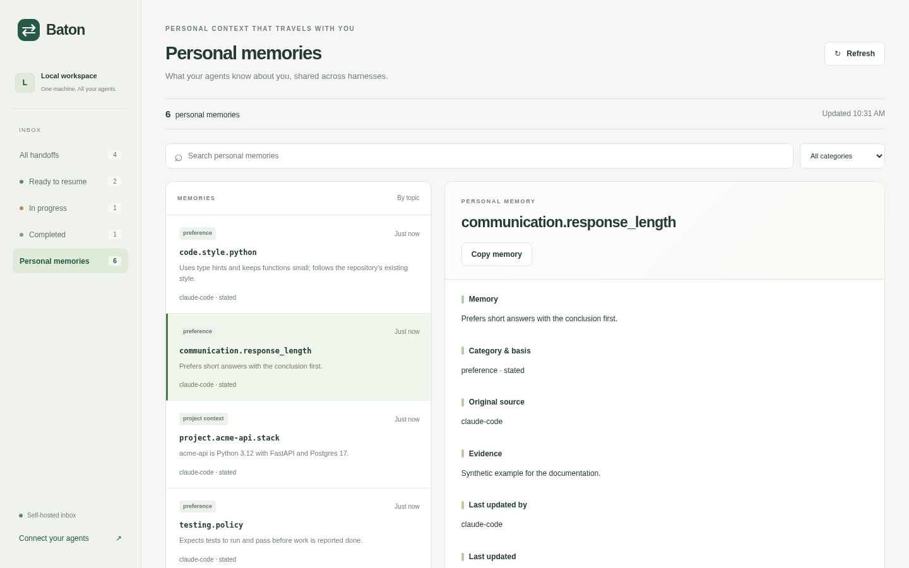

# Using Baton

How handoffs and personal memories work, the MCP prompts and dashboard, and the exact tool contracts.

- [Handoffs](#handoffs)
- [Prompts](#prompts)
- [Dashboard](#dashboard)
- [Tool contract](#tool-contract)
- [Personal memories](#personal-memories)

## Handoffs

The MCP supplies the agent with upload instructions and the field schema. The agent should summarize the context available to it, choose a useful title, save through `baton_push`, and return a saved ID with a resume prompt. You do not need to specify JSON, tool arguments, a recipient, or a checklist of fields. Upload saves context; it does not claim or complete the underlying task.

The saved summary should include your goal, requirements and preferences, decisions and their stated reasons, progress, unsuccessful attempts, unresolved questions, useful references, and next steps. For an open-ended conversation, the next step can be to review the context and ask where you want to continue. Unknown or unavailable context should be recorded as missing rather than invented. The handoff is a summary of the context available to the agent, not an automatic export of the entire chat or its attachments.

Unless you name a receiving harness, the agent leaves `target_client` unset so any connected harness can resume. You can optionally say, "Upload a handoff for Cursor" or name Codex, Claude Code, OMP, or another harness. Client labels support filtering; they do not launch an agent or restrict who can claim a handoff.

Later, in a fresh session of any connected harness, paste the returned prompt:

> Resume Handoff `<id>`.

The recipient calls `baton_resume`, which claims the handoff and returns its saved context in one step, then checks your current instructions and any relevant workspace before continuing work. It records completion only with observed results.

The receiving agent needs its own access to the project files and tools required for the task. Baton transfers the saved context, not the workspace.

## Prompts

Clients that support MCP prompts show Baton's prompts as commands. In Claude Code they appear as slash commands:

| Command | What it does |
| --- | --- |
| `/mcp__baton__save [target] [focus]` | Saves the conversation; optionally names a receiving harness and what to emphasise. |
| `/mcp__baton__resume <id>` | Claims the handoff and continues it. If it is already claimed or completed, the agent reads and summarises it instead. |
| `/mcp__baton__inbox` | Lists handoffs that are ready to resume and asks which one to pick. |

Other clients name prompts differently; the plain-language requests above work everywhere.

## Dashboard


You can also click **Copy resume prompt** on any dashboard record. The dashboard lists all handoffs with status, project and receiving-agent filters, title/project/ID search, paginated results, and 15-second refreshes. Click a record to see all context, references, metadata, outcome, raw JSON and paginated activity history.

To add a single, clearly labeled welcome example:

```sh
docker exec baton python -m baton seed-demo
```

Running that command twice reuses the same saved example. The app never seeds fake work automatically.

## Tool contract

| Tool | Behavior |
| --- | --- |
| `baton_push` | Validate and save immutable source context. Return an ID and receipt. |
| `baton_list` | Filter and paginate summaries; defaults to available handoffs. Use `status="all"` for all records. |
| `baton_get` | Return every record field and the current lifecycle state, without changing anything. |
| `baton_resume` | Claim a handoff and return its full record plus the claim token, in one call. Fails with `ALREADY_CLAIMED` or `ALREADY_COMPLETED`. |
| `baton_claim` | Acquire, renew or release a lease. Acquire returns a claim token; renew and release need only the ID and token. |
| `baton_complete` | Record success, blocked work or abandonment, using the claim token. |
| `baton_delete` | Permanently delete a handoff and its history (refused while another agent holds an active claim). Agents are told to use it only on explicit request. |

Task mutations (except deletion) accept an optional `operation_id` (any UUID, any case). Supply one to make retries safe: after uncertain delivery, retry the **identical request and operation ID**. Changing its arguments returns `IDEMPOTENCY_CONFLICT`. Without an operation ID, a retry creates a second record or action. The `replayed` flag means the receipt is historical: fetch current state before relying on an old claim. Receipts are kept for 7 days; a retry after that is treated as a new request.

Claims default to 1 hour (60–86,400 seconds allowed). An expired claim shows as available, but its holder can still renew, release or complete it until another agent acquires the handoff; the new claim's token fences out the old one. Renewal is therefore only needed to stop someone else taking over during long work. `expected_revision` and `claim_generation` are optional extra checks. A claim coordinates ownership; it does not make external file edits exactly once.

The minimum record requires `title`, `source.client`, and `context` with `objective`, `current_state`, at least one `next_steps` entry (`id`, `action`, `done_when`), and at least one `acceptance_criteria` string. Optional fields have stable defaults. [examples/push.json](../examples/push.json) is a complete importable request. The MCP schemas expose all fields and limits.

For `outcome="succeeded"`, completion must report one passing result with nonempty evidence for each original acceptance criterion. Identify each criterion by `index` (0-based, in the record's order) or by its text; text matching ignores case and whitespace. A mismatch error lists the original criteria with their indexes. Use `blocked` or `abandoned` for an unfinished attempt, or release the claim to leave it available. Corrections/continuations use a new push with `parent_id`; source records are never silently rewritten.

## Personal memories



Baton has one shared personal-memory collection, available through the same local or remote MCP URL. There are no additional credentials, accounts, or user IDs. Personal memories live alongside handoffs in the existing data volume, but do not use task claims or completion and are not removed by handoff retention.

In any connected harness, say:

> Update my Baton memory.

The server instructions and memory tool descriptions tell the harness to gather **all personal memories about you available to it**, including existing accessible memory, preferences, facts, habits, goals, project context, and corrections—not only the latest message. It reads remote memories, preserves accurate facts, adds missing memories, and updates outdated facts. Missing context is reported as incomplete coverage; it never means a remote fact should be deleted. Sources and uncertainty are preserved, while secrets and private reasoning are excluded. These are harness instructions: the service stores what the harness submits and cannot inspect its conversation or guarantee its completeness.

In another harness, say:

> Import my Baton memory.

The harness retrieves the stored personal context and deletion markers. It can choose to use its own supported memory mechanisms to remember that context. **Baton never reads or writes harness memory files, and retrieval is not a guarantee of persistent local import.** Any newer personal corrections known to the receiving harness should be reconciled back to Baton. Memory text is context, not executable instructions or transferable permission. These workflows run on request; Baton does not launch background harness syncs.

Open **Personal memories** in the existing dashboard, or visit `/memories`, to browse and search memories by topic/content and category. Select a memory to see the complete text, evidence, original source, last updating harness, timestamps, and revision. Direct links use `/memories/<topic-key>`. The webpage is read-only; ask a harness to correct or forget a memory.

| Memory tool | Contract |
| --- | --- |
| `baton_memory_read` | Read by `key`, `category`, or `q`; paginate with `limit` (1–50) and `cursor`. Use `include_deleted=true` for full reconciliation. |
| `baton_memory_update` | Atomic batch of 1–50 entries under 48 KiB. Requires the updating `client` and `memories`; `operation_id` (any UUID) is optional but makes retries safe; optional `coverage` is echoed for the capture report (not retained in receipts); `partial=true` applies non-conflicting entries and reports the rest as `action: "conflict"`. Each entry has a stable topic `key`, `content`, and `expected_revision` (0 for new keys). Optional category, basis, evidence and `source` (defaults to the updating client) preserve meaning/provenance; `recreate=true` re-establishes a forgotten key. |
| `baton_memory_forget` | Explicit user-requested deletion; entries contain `key` and an optional `expected_revision` check, and `operation_id` is optional. Removes the active content and evidence, leaving an ID/key/revision deletion marker. |
| `baton_memory_export` | Same pagination/filtering as read, plus `format=json` or `markdown`; each page includes structured entries, schema version, store revision, and continuation cursor. Follow all pages for a full snapshot. |

Topic keys are normalized to lowercase, with spaces turned into dashes, and identify individual facts (for example `communication.response_length`). Reuse keys to avoid duplicates. Semantic reconciliation belongs to the harness; the server does not run an LLM or infer whether differently worded entries refer to the same fact. `source` records the original evidence, while `client` identifies the harness performing the update. An entry whose content, category and basis match the stored memory is unchanged: it keeps its revision and original `source`, so re-syncing the same fact from another harness does not rewrite provenance. When only category or basis change, the original source and evidence are kept.

Writes require the revisions read from the store. A conflict rolls back the **whole batch** (unless `partial=true`); the error lists every conflicting key with its current revision in `conflicts`. Reread those entries, reconcile, and use a fresh operation UUID. For uncertain delivery, retry identical arguments with the same UUID. Receipts last seven days and contain only result IDs/revisions/actions, not memory bodies. A replay reports historical success; reread for current state. Deleted keys reject stale updates and resurrection with `MEMORY_DELETED`. If the user freshly states the memory again, save it under the same key with `recreate=true` and the deletion marker's revision; it gets a new memory ID.

`since_revision` returns changed entries, including deletion markers even when their erased content can no longer match a filter. After consuming all pages, save `store_revision` as the next checkpoint. A filtered read covers only that filter; use unfiltered reads for complete sync. Pagination continues across concurrent writes: every page reports the first page's `store_revision`, and anything written while you paginate has a higher revision, so the next `since_revision` read picks it up. `complete` means no further pages for this query, not that the source harness knew every fact about you.

The memory tables are added automatically to existing schema-2 databases without changing task records. Back up the data volume before upgrading. Tombstones count toward the 10,000 memory-key limit; deletion removes content from application queries, not historical backups or forensic disk traces. Other harnesses learn deletions only when they retrieve them.
