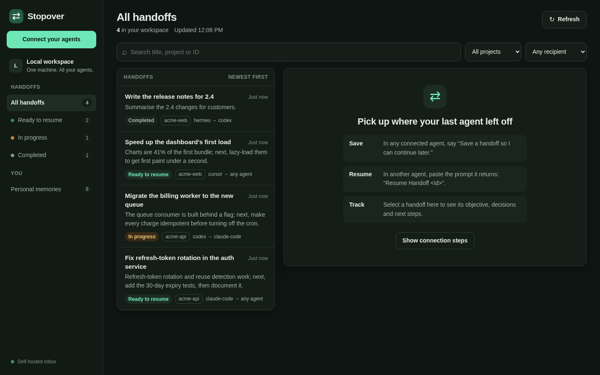

# Using Stopover

This page covers **handoffs**: saving a task in one agent and continuing it in another. Stopover's other feature, sharing your preferences and context between agents, has its own page: [personal memory](memory.md).

The dashboard lets you browse handoffs and copy resume prompts; you make changes through an agent.

## Continue work in another agent

1. In the current agent, say: **“Save a handoff so I can continue later.”**
2. Wait for it to confirm the save and return `Resume Handoff <id>`.
3. Open a fresh session of another agent connected to the same server.
4. Give it access to the project, then paste the resume prompt.

The summary includes the goal, decisions, current progress, and next steps. It includes only context available to the agent, so check that important details were captured before leaving the original session.

You can name a preferred recipient: **“Save a handoff for Cursor.”** This adds a label; it does not launch Cursor or prevent another connected agent from resuming the handoff.

## Find a handoff



Open the dashboard. Search by title, project, or ID, or choose a status:

| Status | Meaning |
| --- | --- |
| Ready to resume | No agent holds an active claim. |
| In progress | An agent holds a claim, normally for one hour. |
| Completed | The attempt ended; its outcome may be succeeded, blocked, or abandoned. |

Select a handoff to read its context and activity. **Copy resume prompt** gives you the text to paste into an agent. The dashboard is read-only and normally refreshes every 15 seconds. Use **Refresh** to check for changes immediately.

For a clearly labeled example, run `docker exec stopover python -m stopover seed-demo`. The app does not create examples automatically.

## When resuming does not work

- **Already claimed:** another agent is working on it. Ask your agent to read it without claiming, or wait until the claim expires. If the original agent is available, ask it to release its claim when it stops working.
- **Already completed:** ask your agent to read the context and outcome. To continue unfinished work, ask it to save a new handoff linked to the original.
- **Files unavailable:** give the receiving agent access to the repository and required tools. Stopover does not transfer files.
- **Tools unavailable:** check the server URL and restart the agent session. See [client troubleshooting](clients.md#troubleshooting-connections).

Claims coordinate agents, but do not lock project files. A claim can expire during long work, so agents should renew it if needed. Completion should describe observed results; a saved summary alone does not prove the work is finished.

## Short commands

**Claude Code:** install five short commands once, from your Stopover checkout:

```sh
mkdir -p ~/.claude/commands
cp clients/claude-code-commands/*.md ~/.claude/commands/
```

Start a new Claude Code session, then type `/stopover` to see them:

| Command | What it does |
| --- | --- |
| `/stopover-save [agent] [focus]` | Saves the conversation as a handoff. Optionally name the agent that should pick it up and what to emphasise. |
| `/stopover-resume [id]` | Resumes that handoff. Without an ID, lists the handoffs ready to resume and asks which one. |
| `/stopover-inbox` | Lists handoffs that are ready to resume and asks which one to pick. |
| `/stopover-memory-update [fact]` | Saves what the agent knows about you to your [personal memory](memory.md), or one fact you name. |
| `/stopover-memory-import` | Loads your personal memory into the session. |

They work with any server name you registered Stopover under. They are named `stopover-…` because Claude Code already has a built-in `/resume`.

**Other agents:** clients that support MCP prompts show Stopover's prompts as commands, named by the client (Claude Code also shows them, as `/mcp__stopover__save` and so on). The plain-language requests above work everywhere.

## Important limits

All users of one Stopover server share the same handoffs and personal memories. Keep it on localhost or an appropriately restricted private network.

Do not save secrets. Your receiving agent may send context to its model provider. Handoffs are summaries, not complete conversation exports or transfers of past permission.

For exact tool fields, retries, claim tokens, and pagination, see the [API reference](api.md).

See [operations](operations.md) for backup and retention, and [implementation](implementation.md) for architecture and integrations.
